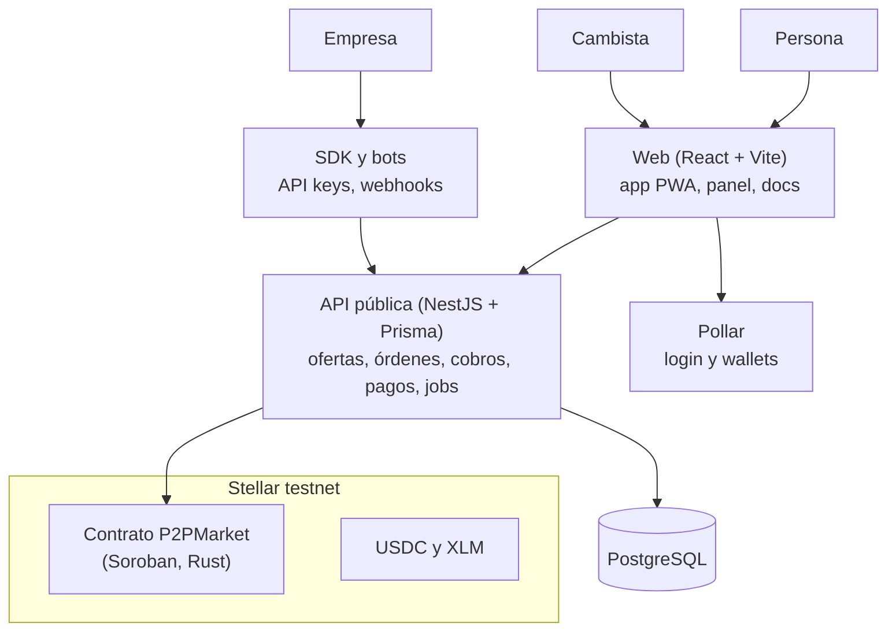

# Pier

**De soles a dólares digitales, con Yape.** Un mercado P2P de USDC contra moneda local sobre
Stellar, con una app de pagos para personas, un panel para comercios y una API pública.

Proyecto del equipo **Los Estellares** para la buildathon **Stellar Codember Perú 2026**.

## El problema

En el Perú los pagos digitales ya son cotidianos con Yape y Plin, pero pasar de soles a dólares
digitales todavía depende de exchanges extranjeros y de su mercado P2P. No hay una rampa nativa de
Stellar, regulada y operativa, que conecte los soles con la red.

Quien quiere ahorrar, enviar o cobrar en dólares digitales termina usando plataformas pensadas
para traders, con pasos que confunden a quien nunca usó cripto.

**Usuario objetivo:** personas en el Perú que ya usan Yape, Plin o transferencias por CCI y quieren
dólares digitales sin aprender cripto; y negocios que cobran en soles y quieren recibir o pagar en
USDC.

## La solución

Pier es un mercado P2P donde la persona solo escribe un monto y el mercado elige a un cambista
con historial. No hay libro de anuncios ni regateo.

- **Compra y vende USDC pagando con Yape, Plin o CCI.** La cotización muestra el precio, la
  comisión y el monto final antes de confirmar.
- **Sin custodia.** Los USDC del cambista quedan bloqueados en un contrato de Soroban hasta que
  quien recibe los soles confirma que llegaron. Si se vence el plazo, se devuelven solos; si hay
  desacuerdo, decide un árbitro que solo puede repartir entre comprador y vendedor.
- **Sin comisiones de red para el usuario.** La API paga las comisiones de Stellar (fee-bump) y
  patrocina la activación de cuentas.
- **Fácil de empezar.** Se entra con correo o Google y la wallet de Stellar se crea sola (Pollar).
- **Envíos y pagos.** Enviar y recibir USDC por @usuario, enlace o QR; pagar el QR de una tienda
  (Yape, Plin) a través de un cambista del mercado.
- **Para negocios.** Cobros en soles con link o QR que se reciben en USDC, pagos masivos, bots de
  cambista y webhooks, todo por API.

### Por qué Stellar

- Comisiones de red mínimas y confirmación en segundos, aptas para pagos pequeños.
- USDC de Circle nativo en la red.
- Contratos de Soroban para el escrow de cada orden.
- Estándares del ecosistema: SEP-10 (autenticación de wallets) y SEP-7 (solicitudes de pago).

## Demo

- **Video (máx. 3 min):** _pendiente_
- **App desplegada:** _pendiente_
- **Modo demo local** (sin backend, datos de ejemplo en soles): `npm run dev:mock -w @pier/web`

## Stellar testnet

| Qué                       | Dirección                                                  | Explorador                                                                                                                  |
| ------------------------- | ---------------------------------------------------------- | --------------------------------------------------------------------------------------------------------------------------- |
| Contrato `P2PMarket`      | `CAM26PWR372POJ43R3OGU5JZM2YLOEOGMKDW7P7YTPAMFAH4VQ2F57A5` | [stellar.expert](https://stellar.expert/explorer/testnet/contract/CAM26PWR372POJ43R3OGU5JZM2YLOEOGMKDW7P7YTPAMFAH4VQ2F57A5) |
| Sponsor (paga comisiones) | `GBRF3NAEZXRSDYHWPX2ERKRFYFGGYA5SIWP7R5HFYY4VKQHLJZJHO27A` | [stellar.expert](https://stellar.expert/explorer/testnet/account/GBRF3NAEZXRSDYHWPX2ERKRFYFGGYA5SIWP7R5HFYY4VKQHLJZJHO27A)  |
| Cambista de prueba 1      | `GB5GXDFHZEUMSID7OZ6OVDROLQZKZ2Q7RQKUTKAGO52XMS5ITO3SE6UX` | [stellar.expert](https://stellar.expert/explorer/testnet/account/GB5GXDFHZEUMSID7OZ6OVDROLQZKZ2Q7RQKUTKAGO52XMS5ITO3SE6UX)  |
| Cambista de prueba 2      | `GC3VG5NT3W4Y3BU6OEGWO3T7A6SG42YJLXBX3PNX4Z2D2CPR6OBNOPE3` | [stellar.expert](https://stellar.expert/explorer/testnet/account/GC3VG5NT3W4Y3BU6OEGWO3T7A6SG42YJLXBX3PNX4Z2D2CPR6OBNOPE3)  |

Activos del mercado en testnet: USDC de Circle y XLM.

## Arquitectura



| Componente            | Qué hace                                                                                                                                                                                                       | Tecnología                                                                      |
| --------------------- | -------------------------------------------------------------------------------------------------------------------------------------------------------------------------------------------------------------- | ------------------------------------------------------------------------------- |
| `apps/web`            | App de pagos instalable (`/app`), panel para comercios (`/dashboard`), página de cobro (`/pay/:id`), documentación (`/docs`) y portada. Español e inglés.                                                      | React 19, Vite 8, Tailwind 4, React Router, `@stellar/stellar-sdk`, Pollar, PWA |
| `apps/api`            | API pública: cuentas, ofertas, cotizaciones, órdenes, cobros, pagos masivos, webhooks y rutas de la app. Procesos automáticos: matcher, indexer de la red, vencimientos y envío de transacciones patrocinadas. | NestJS 12, Prisma 7, PostgreSQL, Soroban RPC                                    |
| `packages/contracts`  | Contrato `P2PMarket`: liquidez de cambistas, bloqueo por orden, liberación, cancelación, disputas y comisiones. No es actualizable: el dueño nunca puede mover fondos.                                         | Rust, `soroban-sdk`                                                             |
| `packages/sdk`        | Cliente TypeScript de la API, verificación de webhooks y un bot de cambista de referencia.                                                                                                                     | TypeScript                                                                      |
| `packages/payment-qr` | Lee lo que la app escanea o pega: direcciones Stellar, SEP-7, enlaces de pago y QR de comercios (Perú, Argentina, PIX).                                                                                        | TypeScript                                                                      |

### Cómo funciona una compra

1. La persona escribe cuánto quiere pagar en soles y elige Yape, Plin o CCI.
2. La API cotiza y elige un cambista por precio, límites e historial.
3. El contrato bloquea los USDC del cambista para esa orden, con un plazo de pago.
4. La persona paga el monto exacto desde una cuenta a su nombre y toca «Ya transferí».
5. El cambista revisa que el pago llegó y libera: el contrato envía los USDC a la wallet de la
   persona.

La venta (retiro a Yape, Plin o CCI) es el camino inverso: los USDC de la persona quedan bloqueados
hasta que confirma que recibió los soles. Cada orden tiene un chat con el cambista para
comprobantes.

## Pier frente a otras opciones

|                                         | Pier                                                                                                                        | Binance P2P                                                                    | Casas de cambio digitales                 | Anchor regulado en Stellar                      |
| --------------------------------------- | --------------------------------------------------------------------------------------------------------------------------- | ------------------------------------------------------------------------------ | ----------------------------------------- | ----------------------------------------------- |
| Quién guarda el dinero durante la orden | Un contrato en Soroban; nadie puede moverlo fuera de sus reglas                                                             | Binance                                                                        | La casa de cambio                         | La empresa del anchor                           |
| Cómo se elige la contraparte            | El mercado asigna el mejor precio y, a igual precio, la mejor reputación                                                    | La persona elige un anuncio de una lista                                       | La empresa es la contraparte              | La empresa es la contraparte                    |
| Medios de pago en soles                 | Yape, Plin y CCI                                                                                                            | Yape, Plin y bancos                                                            | Transferencia bancaria                    | Transferencia bancaria                          |
| Qué entrega                             | USDC en una wallet de Stellar                                                                                               | Cripto dentro de Binance                                                       | Dólares en una cuenta bancaria            | USDC en Stellar, a través de wallets integradas |
| Costo para la persona                   | Comisión de protocolo (configurable hasta 3%; 0% en el lanzamiento) más el precio del cambista, mostrado antes de confirmar | Sin comisión visible al tomar un anuncio; el costo va en el precio del anuncio | Diferencia entre precio de compra y venta | Según cada anchor                               |
| Para empresas                           | API, cobros con link o QR, pagos masivos y webhooks                                                                         | —                                                                              | —                                         | API para wallets y fintechs                     |

Las referencias de mercado son públicas y cambian con frecuencia; se toman como aproximadas.

## Lanzamiento y crecimiento

Pier es un mercado de dos lados: necesita personas que quieran cambiar y cambistas con liquidez.

- **Campaña de lanzamiento sin comisión.** Una oferta pública para los primeros usuarios y cambistas:
  durante el lanzamiento no se cobra comisión de protocolo. El contrato permite fijarla en 0% sin
  cambiar código, y la comisión se activa después, cuando haya volumen.
- **Qué gana el cambista.** El diferencial entre su precio de compra y de venta, sin pagar por
  publicar ofertas, con órdenes asignadas automáticamente y un historial público que mejora su
  posición en el mercado.
- **Demanda desde empresas.** Los cobros, pagos masivos e integraciones por API traen órdenes a los
  cambistas desde el primer día, y son la vía de ingresos a mediano plazo (comisión de integrador).

## Limitaciones y hoja de ruta

Pier funciona hoy en Stellar testnet, sin dinero real. Antes de operar en la red principal:

- **Identidad de los cambistas.** Hoy Pier verifica que la wallet sea del cambista (SEP-10), no su
  identidad. Se sumará verificación de identidad con el estándar SEP-12 de Stellar.
- **Cumplimiento regulatorio.** El intercambio entre activos virtuales y soles está sujeto a las
  normas de prevención de lavado de activos para proveedores de servicios de activos virtuales (PSAV)
  ante la UIF-Perú (Resolución SBS N.° 02648-2024).
- **Aliados regulados.** Evaluar una alianza con un anchor o PSAV registrado en el Perú, como cambista
  dentro de Pier o como rampa alternativa.
- **Disputas.** El contrato ya permite que un árbitro resuelva disputas; falta la pantalla para
  gestionarlas.
- **Confirmación de pagos.** La confirmación de los pagos por Yape, Plin o CCI es manual: la hace
  quien recibe los soles, con comprobante en el chat de la orden.
- **Despliegue público** de la app y la API, y prueba completa del inicio de sesión con Pollar.

## Cómo ejecutarlo

Requisitos: Node.js 24.9 o superior y npm.

```sh
npm install
npm run dev:mock -w @pier/web     # la web completa sin backend, con datos de ejemplo
```

El mercado completo en Stellar testnet (base de datos, contrato, API, bots de cambista y web):

```sh
npm run dev:stack -- --testnet    # levanta todo; imprime URLs y claves de prueba
npm run dev:stack -- --stop       # lo detiene
```

Las claves de prueba se guardan en `.dev-stack/`, que no se sube al repositorio. Para el inicio de
sesión real hace falta una clave pública de Pollar (`VITE_POLLAR_PUBLISHABLE_KEY`); sin ella la web
usa el modo demo. El detalle está en [`docs/HANDOFF.md`](docs/HANDOFF.md) y en el README de cada
paquete.

## Pruebas

```sh
npm run typecheck
npm run lint
npm test                          # incluye cargo test del contrato
npm run test:e2e -w @pier/web     # flujos completos en navegador (Playwright, modo demo)
```

## Integrantes

| Integrante                    | GitHub                                           | Rol                                                                            |
| ----------------------------- | ------------------------------------------------ | ------------------------------------------------------------------------------ |
| Eduardo Emanuel Guzman        | [@Emanuel250YT](https://github.com/Emanuel250YT) | Desarrollo: arquitectura, backend y front, contrato, API y web                 |
| Yoshio Cantaro Calderon       | [@gyolavoz](https://github.com/gyolavoz)         | Producto, diseño, front, QA y documentación                                    |
| Alonzo Gusmaro Zapata Salazar | [@20193688-oss](https://github.com/20193688-oss) | Investigación de mercado (competencia, comisiones, rampas), QA y documentación |

## Uso de IA y código de terceros

- **IA:** el equipo usó **Claude** (Anthropic) como asistente para escribir código, pruebas y
  documentación. Los commits hechos con su ayuda lo indican con `Co-Authored-By: Claude`.
- **Código de terceros:** librerías de código abierto declaradas en cada `package.json` y
  `Cargo.toml` (entre otras: `soroban-sdk`, `@stellar/stellar-sdk`, NestJS, Prisma, React, Vite,
  Tailwind CSS, Pollar).
- **Inspiración de diseño:** referencias de Dribbble usadas solo como inspiración visual:
  [Stablecoin Wallet App — OneDosh Redesign Concept](https://dribbble.com/shots/27822709-Stablecoin-Wallet-App-OneDosh-Redesign-Concept)
  y [Crypto Stablecoin Ramp in Mercury](https://dribbble.com/shots/26635558-Crypto-Stablecoin-Ramp-in-Mercury).

## Licencia

[MIT](LICENSE).
